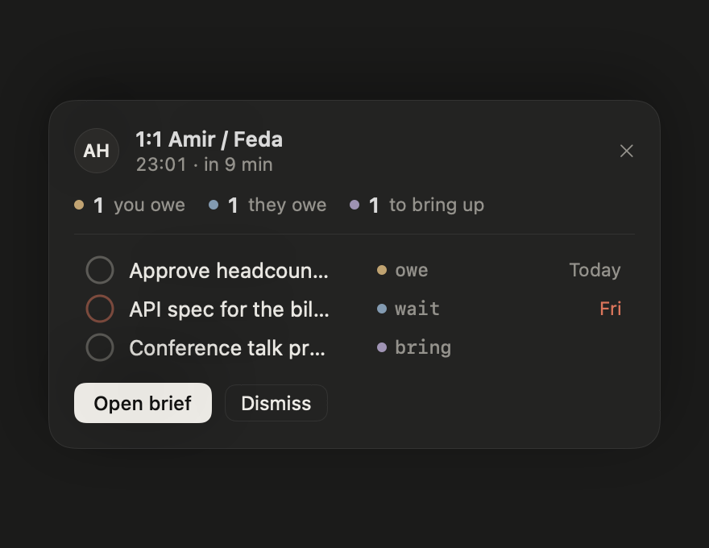

# Jaffloop

A macOS menu bar app for engineering managers. It tracks **what you owe people, what they owe you, what to bring up with them, and what you told them**, so nothing from a fast-moving week gets lost.

Capture in one line. Everything stays on your Mac. Claude can read and write your data through a local MCP server, and the app itself has no AI and makes no network calls.


## Features

- **One-line capture** with a global hotkey (default `⌥Space`, or record your own in Settings). Parsed locally and live, shown as chips.
- **Six item kinds**: `owe`, `wait`, `bring`, `task`, `said`, `note`.
- **Today** with sections for Slipping, Overdue, Today, Waiting on (stale), Check in (people past their 1:1 cadence) and Inbox.
- **Person pages** with a cadence ring, last 1:1, next meeting, and four sections: I owe them, They owe me, Bring up, Said log.
- **Promise ledger**, **Inbox triage by keyboard**, **⌘K search** (FTS5, with `@person`, `kind:`, `before:` filters).
- **Pre-meeting brief** 10 minutes before a calendar event with a person you track, and a **morning brief** on weekdays.
- **Local notifications** with Done / Snooze actions, quiet hours, and batching.
- **MCP server** (`jaffloop-mcp`) with 12 tools and 3 resources, a read-only mode, per-person hiding, and an audit log.

| Capture | Pre-meeting brief |
| --- | --- |
|  |  |

| Person page | Promise ledger |
| --- | --- |
|  |  |

| Menu bar popover | Morning brief |
| --- | --- |
|  |  |

| Light mode | Claude (MCP) settings |
| --- | --- |
|  |  |

## Capture syntax

`[prefix] [@person] text [date] [recurrence] [#tag] [!]`

| You type | Result |
| --- | --- |
| `owe @sara review RFC fri` | owe, Sara, due Friday (all-day) |
| `wait @amir API spec mon 10:00` | wait, Amir, due Monday 10:00 |
| `bring @sara workload, promotion timeline` | bring, Sara, no date |
| `said @sara "we'll revisit headcount in Nov"` | said, Sara, quote stored verbatim |
| `todo prepare Q4 plan thu #planning !` | task, due Thursday, tag, pinned |
| `todo 1:1 prep every mon 09:00` | recurring weekly task |
| `@sara ask about on-call rotation` | no prefix with a person defaults to `bring` |
| `buy usb-c cable` | no prefix and no person defaults to `task` (goes to the Inbox) |

Dates: `today`, `tomorrow`, weekdays, `next mon`, `15 nov`, `in 2h`, `eod`, `eow`, `10:00`, `3pm`. Reminders: `remind 1h`, `remind fri 9:00`. Recurrence: `every mon`, `every 2 weeks`, `monthly`, `weekdays`. Anything the parser cannot read stays in the title.

## Install

Requires macOS 14 or later on Apple Silicon.

1. Download `Jaffloop-0.0.2.zip` from [Releases](../../releases) and unzip it.
2. Move `Jaffloop.app` to `/Applications`.
3. Open it. See [Signing](#signing-and-notarization) if macOS says it cannot verify the app.

Verify the download against `Jaffloop-0.0.2.zip.sha256`:

```sh
shasum -a 256 -c Jaffloop-0.0.2.zip.sha256
```

## Use it with Claude

The app bundles `jaffloop-mcp`, a stdio MCP server over the same SQLite file (`~/Library/Application Support/Jaffloop/jaffloop.sqlite`). Settings, then Claude (MCP), shows a ready-made command. For Claude Code:

```sh
claude mcp add jaffloop -- /Applications/Jaffloop.app/Contents/MacOS/jaffloop-mcp
```

For Claude Desktop, add the same binary as a stdio server in its MCP config. Then ask things like "Prep me for my 1:1 with Amir" or "What did I promise Sara this month?".

Tools: `capture`, `add_item`, `list_items`, `get_person`, `list_people`, `complete_item`, `snooze_item`, `update_item`, `log_interaction`, `search`, `prep_brief`, `week_summary`. Resources: `jaffloop://today`, `jaffloop://ledger`, `jaffloop://person/{handle}`.

Privacy: people marked hidden are excluded from every tool and resource. Read-only mode blocks every write tool. There is no delete tool. Writes are tagged `source = mcp` and listed in the audit log. The app refreshes within a second when the server writes.

## Build from source

```sh
swift test                 # 33 tests: parser, derived rules, store, MCP
swift run Jaffloop         # run unbundled (no notifications; use the .app for those)
scripts/build-app.sh       # signed Jaffloop.app and zip in dist/
```

Re-render the README screenshots with `dist/Jaffloop.app/Contents/MacOS/Jaffloop --screenshots docs/screenshots`.

Layout: `JaffloopCore` (models, GRDB/SQLite with WAL and FTS5, parser, rules, MCP server), `Jaffloop` (SwiftUI and AppKit app), `jaffloop-mcp` (stdio entry point). The spec is in [`docs/jaffloop-spec.md`](docs/jaffloop-spec.md) and the design mocks in `docs/jaffloop-mocks.html`.

## Signing and notarization

Jaffloop is distributed outside the Mac App Store, because the MCP server needs unsandboxed access to the database. Builds are signed with a **Developer ID Application** certificate and the **hardened runtime**, then (for public releases) notarized by Apple.

`scripts/build-app.sh` does the following:

1. Builds a release binary and assembles `Jaffloop.app` (the app and `jaffloop-mcp` in `Contents/MacOS`).
2. Signs the nested `jaffloop-mcp` first, then the app, with `--options runtime --timestamp`. The only entitlement is read-only calendar access (`scripts/Jaffloop.entitlements`).
3. Verifies with `codesign --verify --deep --strict`.
4. Zips with `ditto` and writes a SHA-256 checksum.
5. If `NOTARY_PROFILE` is set, submits to Apple, waits, staples the ticket, and checks with `spctl`.

The signing identity is found automatically, or set it yourself:

```sh
SIGN_IDENTITY="Developer ID Application: Your Name (TEAMID)" scripts/build-app.sh
SIGN_IDENTITY=- scripts/build-app.sh      # ad-hoc, local use only
```

**One-time notarization setup** (needs an Apple ID with an [app-specific password](https://support.apple.com/102654)):

```sh
xcrun notarytool store-credentials jaffloop --apple-id you@example.com --team-id TEAMID
NOTARY_PROFILE=jaffloop scripts/build-app.sh
```

**Verify a build:**

```sh
codesign -dvv /Applications/Jaffloop.app          # Authority=Developer ID Application, flags=runtime
codesign --verify --deep --strict /Applications/Jaffloop.app
spctl --assess --type execute --verbose /Applications/Jaffloop.app   # "accepted, source=Notarized Developer ID"
```

**Release status:** the v0.0.2 zip on GitHub is Developer ID signed with the hardened runtime and **notarized and stapled by Apple**, so it opens on first launch without a Gatekeeper warning. The v0.0.1 zip was signed but not notarized.

## Not in v1

No sync, iOS app, sharing, AI inside the app, planning tools, or Mac App Store build. See the spec for the full list and the post-v1 ideas.
